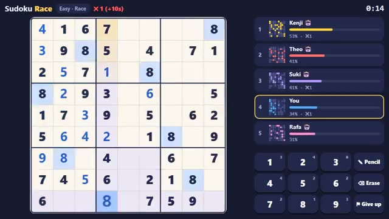

# Sudoku Race

Same sudoku for everyone. First to fill it wins. A multiplayer starter game from [Multiplayer Agent](https://multiplayeragent.com): 2D, versus (or co-op), 1–8 players, with bot racers that fill empty seats.

## How it plays

Everyone gets the same puzzle at once. Fill every row, column and box with 1 to 9 while you watch your rivals' progress bars and which squares they've filled (never their digits). A wrong digit adds 10 seconds, so don't guess. Switch to Co-op to solve one grid together.

**Controls:** Click or tap a square, then type or tap a number; Shift+number or ✎ Pencil for notes, arrow keys to move.

## Make it yours in the Game Builder

Open the [Game Builder](https://multiplayeragent.com), choose **Start from a starter game** and pick Sudoku Race. It opens as version 1 in your studio, ready to play and publish. Then ask for changes, for example:

- Make it a 6×6 sudoku with letters instead of numbers
- Give the winner a crown that shows next to their name in the next race
- Add a hint button that fills one square but costs 30 seconds

## Run it yourself

1. Get a free publishable key (`pk_…`) at [multiplayeragent.com](https://multiplayeragent.com).
2. In `index.html`, put it in place of `pk_REPLACE_ME` in the `MP_CONNECT` block.
3. Open `index.html` in a browser. No build step and no server needed.

Without a key it still runs, offline against bot racers.

## How it is built

- One `index.html`. The comment at the top of the script maps the code and explains the multiplayer.
- Clue counts per difficulty, the mistake penalty, bot speeds and timers are in `CONFIG`. Puzzles come from a seed, and a solver checks each one has exactly one solution.
- **Host-run rounds:** The host's browser picks the puzzle, collects finish times and starts the next race; if it leaves, the next player takes over.
- **Bots:** Bot racers solve at a human pace (and make mistakes) when the room is quiet.
- **Leaderboard:** Fastest race time for each difficulty, penalties included.
- **Live sync:** Rivals' progress and filled squares update live; in Co-op everyone fills one grid and sees each other's cursors.
- **Live ops:** The owner can change how many seconds a mistake costs without a new deploy.
- `?attract` runs it offline with bots only. The preview video is recorded from it.

## License

MIT.
